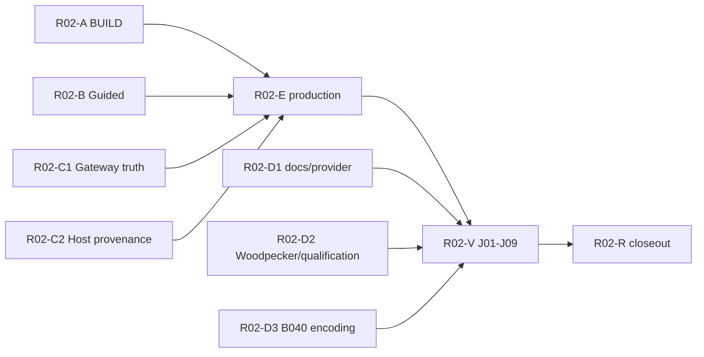

# v0.3.0 R02 — Minimal L2 / API Amendment R1 (Issue #259 / Owner #260)

**Scope:** approved in conversation on 2026-10-31, owner event [#260@6545077384](https://github.com/kaicreator-mm/shun-assistant/issues/260#issuecomment-6545077384). Planning artifact only; not a Builder Claim, source implementation, CI success or independent R03.

**Immutable pre-fix candidate:** `version/v0.3.0@b97fad6c435c8b4895cf24af2c0f26353a60d3af`, tree `891a749a1164e5ccb150c80340d5f172b2ab62e9`, Task Pack R1 `e988ccc6962d35bb1612f82c469086f54958dc1e`. Product #214, L2 #217, DAG #218 retain their original freeze records; **this is a successor remediation** not a historical rewrite.

## Controlled deltas only

1. **F03/BUILD:** T09's plain-data BUILD must supply real K/S/B/C runtime code via the *public* DomainHarness v0.10.3 package contract and be the *same* build activated in the production Control API. No throwing K/S placeholders, alternate T11 test BUILD, duplicate Kernel or private SDK imports. Real Host bound at activation is not a test-only substitute.
2. **F02/Guided:** add `GET /api/v03/guided/state` and `POST /api/v03/guided/decision` backed by durable Host single-use evidence and currently selected Case/root/StepSpec/currentness. Form acknowledgment, disclosure consent, ActionController R2 approval and Kernel Permit remain four distinct facts; no auto-grant/auto-effect. Explicit CN/EN, 409 stale/replay and UNKNOWN semantics.
3. **F04/Gateway:** a Promise resolved by `DomainApp.send` is **only a forwarded call**. HTTP must faithfully convey K refusal/admission and nested terminal effect/UNKNOWN, never `SENT/200` implying completion or admission. Never blind-retry UNKNOWN. Refused malformed input must still produce zero sends/zero journal.
4. **F05/Provenance:** a public `@shun/domain-computer` import must **not** contain the Host-only observation issuer. Host authority must be non-caller-constructible, scoped/current, replay-resistant. Keep semantic selection parser/outputs compatible where possible; E single-writer owns public export rewiring.
5. **F01/Production:** only R02-E changes `main.ts`, `server.ts`, `apps/control-ui/public/v03/**`, public package `index.ts`, manifests and lockfile; it binds one selected K + Shun Host + existing ActionController/Trusted Sender in the shipping process. Failure to activate returns typed unavailable; must not fall back to fake or bypass K.
6. **F06/Acceptance:** validate same shipping process for J01–J09 on real Windows Node>=24 and Woodpecker (not GitHub Actions). No independent R03 PASS from builder, no paid-model/physical effects without separately scoped owner authorization.
7. **Q01–Q06:** Q01 live labels #229–#241 normalized to state:done, no history rewrite. D1/D2/D3 address guides/signed Provider custody and packaging, actual nested Woodpecker gate, and B-040 UTF-8 collector; old committed evidence must remain unchanged.

## Task DAG (9 edges, 10 distinct nodes)

All seven predecessor lanes A/B/C1/C2/D1/D2/D3 can start concurrently **after** native GraphQL issue dependency readback and valid CAS Builder Claim. Proposed issue source scope and acceptance: `R02-REPAIR-TASK-PACKS-R1.json` in this directory. No sibling writes, duplicate writers, uncontrolled node/process permissions, weakening negative tests or migration of frozen prior-task write sets.

## Pre-dispatch required steps

- Independent review this *exact planning-PR HEAD/tree* for scope conflicts, SDK public ABI, GraphQL edge direction and final literal allowed_write_set.
- Land approved planning records **only to `version/v0.3.0`** following proper independent plan review. No main/v0.2.
- Create exact 10 new GitHub Task Issues; native `blocked_by` write+readback **9 edges**, no Markdown-only substitutes.
- One current accepted CAS `DISPATCH_CLAIMED` per root builder, unique protected key, explicit operator identity/currentness and Task Pack SHA before any source byte or dependency install. Source tasks do not inherit T00–R01 closed Claims.
- Existing Woodpecker backend must actually execute tests and return observable exit codes; if unavailable, remain UNKNOWN/blocked.

## Change classification

- **Product:** no user-scope expansion, frozen J01–J09 retained.
- **L2:** minimal entrypoint/API/issuer/activation wiring correction; still one K Permit/Journal/UNKNOWN authority, one Host effect authorization/dispatcher and one trusted LLM Sender.
- **DAG:** approved new remediation-only nodes and edges; original 14-node history not modified.
- **Owner exclusions:** paid DeepSeek, physical Windows effects/devices, publish/tag/release/main merge.
