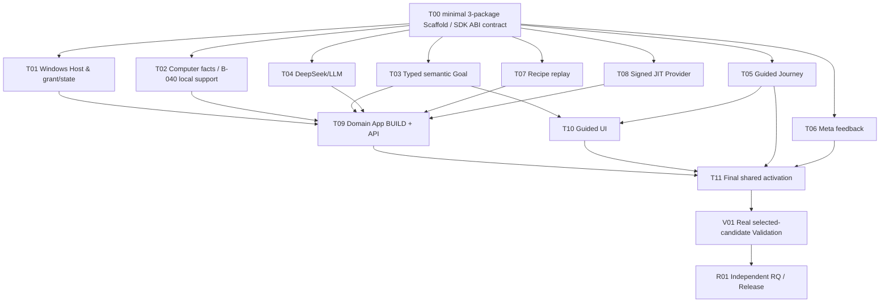

# Shun v0.3 — Provisional Task DAG R0 (14 Nodes, 22 Edges)

**Status:** `PLANNED_PROVISIONAL / NOT_FROZEN / NATIVE_ISSUE_DEPENDENCIES_NOT_MATERIALIZED / NO_CLAIMS`. Source authority: **Product Owner Frozen** checkpoint `version/v0.3.0@c8334c7723eecf7fbbb6895b1defd6439edc6b95` with independently reviewed PR #215 source `4c2f8e84b6e6f3f5b526e52d01356159f2dce0e7` (R2 0/0/0) and owner issue #214 comment 6477255283; L2 [#217](https://github.com/kaicreator-mm/shun-assistant/issues/217) **Architecture Owner Frozen** in actual `version/v0.3.0@3358080bd8fabd097347ef6df12f9b7e9b223fd0`, freeze record [`L2-FREEZE.md`](../../architecture/v0.3/L2-FREEZE.md) blob `2f1601de193ad79c12bd3ccd660039836bac56f9` and immutable frozen L2 blob `8c555aff66d3006a1dbd4fb523e350f70c5db490` (independent R2 PASS 0/0/2). This **DAG** is still provisional: independent #218 R1 at that snapshot returned **BLOCK 0/1/1**; the present candidate addresses only the reported P1 acceptance and P2 stale metadata, and requires fresh exact-HEAD independent R2. ADS project adoption #216 still not effective. This DAG is **not** an executable authorization even if an Issue exists.

Canonical proposed task descriptions, write sets, roles, Review and acceptance: [machine-readable Task Packs](TASK-PACKS-R0.json). Real post-freeze GitHub **native Issue Dependencies** replace this document as live DAG; Markdown edges alone do not authorize Task dispatch.

## 1. DAG topology / maximum safe parallelism



**14 nodes, 22 unique edges, acyclic by construction.** Upstream DomainHarness v0.10.3 [Git-source-only tag](https://github.com/kaicreator-mm/domain-harness/tree/v0.10.3) now exists at `061376f4a023070f215f9feffad5c24d96d503cb` (tree `099cdc831aef63befd62aaede7e7a853d1be468f`); it has CONDITIONAL RQ and **no npm v0.10.3 publish**. T00 consumes independently built/pinned four public workspace packs; do not create an SDK publication predecessor or extra task. DH [#1437](https://github.com/kaicreator-mm/domain-harness/issues/1437) remains a raw `DomainApp.send` malformed input/Case poisoning risk; T09's existing Control API seam owns validation **before** send, T11 owns single exposed endpoint and V01 proves invalid→valid same Case zero-journal denial. No new DAG node/edge from this known SDK limitation. The legacy `ShunStore` retains business data and idempotent application receipts, whereas the old `WorkflowEffectJournal` must not remain a second physical-effect dispatcher beside selected K. Each edge exists because the downstream step consumes an actual contract/source, or is a release qualification gate; the graph **does not** chain unrelated tasks merely for coordination.

### Workfront view

| Wave | Immediately eligible by planned predecessors (subject to real legal Claim) | Parallelism | Blocking reason |
| --- | --- | --- | --- |
| 0 | T00 | 1 | public exported SDK shape / shared manifest owner |
| 1 | T01 T02 T03 T04 T05 T06 T07 T08 | **8 independent lanes** | all consume T00 frozen internal contract; disjoint directories |
| 2 | T09 and T10 | **2 independent integration lanes** | T09 consumes Host/Computer/Semantic/LLM/Recipe/Provider; T10 consumes Semantic+Guided |
| 3 | T11 | 1 shared activation writer | versioned app exports/control API existing entrypoint/UI app.js/lockfile are shared |
| 4 | V01 | independent validator | actual selected public SDK/Node24/Windows/DeepSeek/Guided/Meta/negative journeys |
| 5 | R01 | independent whole-version qualifier | Release gate, source identity, packaging; never Builder self-RQ |

T06 Meta can be developed and reviewed **without waiting for T09**; only final activation T11 consumes it. T05 Guided Journey is independent of LLM T04 because an offline guided path is mandatory. T02 does not await T01 for local pure diagnosis source; the real Windows Host trust is enforced at T09/T11. Existing B-040 local-only `vertical-support` is incorporated within **T02** (no 15th task/extra edge), keeping its minimization schema and zero-egress contract. T10/T11 must verify real **CN/EN nondeveloper UI** scope/approval/refusal equivalence; this is not only LLM language testing.

## 2. Source ownership and scaffold-first design

Three new packages **not nine**: `packages/domain-computer` (disjoint B/S/C source folders), `packages/domain-host` (trusted Host adapters by folder), `packages/domain-app` (single central selected BUILD/runtime assembly owner). This reuses `pnpm-workspace.yaml` already matching `packages/*`, existing Windows Executor and ActionController, existing Control UI/API, existing Recipe and Provider.

T00 owns all three new `package.json` and `tsconfig.json`, plus sole `src/contracts/**`. T01–T08 may write **only their exclusive child directories** and corresponding tests. No task changes sibling package exports, root pnpm workspace or source of another lane. T09 owns `packages/domain-app/src/build/**`, `.../src/api/**`, `apps/control-api/src/v03/**`. T10 owns new `apps/control-ui/public/v03/**` files. **Only T11** owns existing `apps/control-api/src/server.ts`, `apps/control-ui/public/app.js`, all three new package top-level `src/index.ts`, and `pnpm-lock.yaml`. Native Windows files, `packages/authorization`, all old v0.2 journaling and user data are **not** globally opened for write.

**T00 is the actual Scaffold source generation task**, not a separate second Task DAG. Its exact admission/negative requirements are [SCAFFOLD-LAYOUT](SCAFFOLD-LAYOUT.md); under ADS 2.4A it could be admitted *before DAG* only if Product/L2 frozen and a real pre-DAG planning Claim is independently accepted. **Preferred:** activate T00 after canonical DAG Freeze to avoid redundant gate.

## 3. Work item → agent capability & conduct

| Lane | Best execution body | Evidence / handoff |
| --- | --- | --- |
| T00–T08 | WEB/GitHub source writes **where legal and actually supported**, otherwise LOCAL Node24 Codex/Claude/ZCode | accepted Task Claim, exact approved path, real Node24 typecheck/positive+negative, true exit status |
| T01 Windows trust | Windows LOCAL for physical guard only; source/negative harness may be WEB+CI | real OS object/path currentness, K/Host permit collision and zero-execution |
| T04 DeepSeek | LOCAL trusted Host only for paid real calls, contract/negative tests CI | explicit bounded spend/secret consent, no token leakage, UNKNOWN no blind retry |
| T09/T10 | source WEB/CI or LOCAL, **two disjoint integration branches** | real selected ABI in T09; UI independent of authority, no fake grant |
| T11 | one authorized integration Builder | reconcile actual accepted ancestors; no concurrent editor for shared imports/entrypoints |
| V01 | independent Validator + LOCAL Windows physical Host | actual installed/packaged SDK and user journeys; no inherited PASS |
| R01 | independent whole-version Release Qualifier & authorized merger | exact qualified candidate SHA/tree/RQ, no self-issued PASS or main touch |

All Builder roles must resolve `Input → allowed acts → evidence → refusal → exit/handoff` from accepted Task Pack, current GitHub source, pinned ADS and native Task admission. Logical actor identity is not inferred from GitHub login. A change to Task scope/write set after Freeze requires lawful DAG amendment, not a helpful unreviewed patch.

## 4. Product/architecture gates and source freeze dependency

```text
ADS v4.18 exact-source project adoption [#216] (qualified source, project-local activation pending)
             \
Product PR #215 R2 PASS → Product Owner Freeze ✓ exact version checkpoint c8334c7
                                      \
L2 #217 R1 BLOCK → independent R2 PASS 0/0/2 → Owner L2 Freeze ✓ blob 8c555aff, checkpoint 3358080b
                                           \
Task DAG v0.3 R1 source/proportionate Review → Task DAG owner explicit Freeze
                                                   \
Native Task Issues + GitHub blocked_by API actual WRITE & GET/READBACK
                                                   \
Claim/Dispatch per Task + exact-version/allow-write-set currentness
                                                   \
 T00 real Scaffold → 8 parallel implementation lanes → 2 integration lanes
                                                   \
                        T11 activation → V01 → R01
```

**No auto permission:** Creating these docs, a planning Issue, draft PR or source branch **never** changes Product/L2/DAG gates or grants source write. A full 40-character installed v0.10.3 SDK source/package identity must be registered before required consumer verification; upstream contract already frozen and does **not** need to be redesigned.

### R1 blocking finding → bounded Task acceptance repair (not yet a PASS)

The independent [DAG R1](https://github.com/kaicreator-mm/shun-assistant/issues/218#issuecomment-6478737511) at frozen version `3358080bd8fabd097347ef6df12f9b7e9b223fd0` found **P1-01**: the actual `T04`, `T11`, `V01` Task Pack acceptance had weakened the frozen L2 R2 **P2-01** by omitting per-call neutral `maxOutputTokens`, `deadlineUnixMs`, expired-deadline **zero HTTP**, duplicate `requestId` non-authority and truthfully mapped `completed/refused/failed/unknown`. They are now explicit **hard acceptance** in [machine-readable Task Packs](TASK-PACKS-R0.json), including actual selected C→trusted Shun Host, unchanged canonical Buffer/ledger/source approval, zero-paid negatives and K/UNKNOWN_COST fencing. If the existing string-only `CloudInterpretPort` cannot honor an individual bounded DTO, the task must **refuse pre-send** rather than silently relax the ceiling/deadline. No new SDK or generic framework required.

R1 **P2-01** was stale machine planning metadata: the new Task Pack correctly binds genuine L2 R1 historical BLOCK, independently PASSed R2, Owner freeze source blob and version checkpoint; this DAG and handoff now say **L2 FROZEN** but **Task DAG NOT FROZEN**. A reviewer must recheck this new exact candidate HEAD/blobs and issue its own R2 PASS/BLOCK. Existing topology stays **14 nodes/22 edges; 44 declared write entries, no path overlaps**, eight parallel lanes. No native Issues/dependencies or accepted CAS Claims have been created.

## 5. Real GitHub native DAG materialization recipe (AFTER freezes)

1. Re-read accepted immutable Product/L2/tree/ADS exact source and frozen Task Pack blob. Check no actual concurrent source writer.
2. Convert each of **T00–T11, V01, R01** into **one native GitHub Issue**, using `ads/github/v3` `type:task` envelope, frozen Task Pack pointer and owner/role/allowed set/Review policy. **Do not create automatic runnable branches or Claims** from planned Issues.
3. For each of the 22 proposed `from→to` edges, call the native GitHub Issue Dependency write API; then GET/read back every successor `blocked_by` set and compare exactly to frozen DAG. `README`, labels or Markdown edges are **not** a substitute. If connector lacks endpoint, record `NATIVE_DAG_NOT_PROVEN` and provide one scoped `gh api`/GitHub UI handoff; HOLD actual dispatch.
4. Record Task issue numbers, native edge identities and current Issue states in the controller checkpoint; issue number references are immutable but graph currentness is checked before **each** dispatch. A source claim without actual accepted serialized CAS Claim remains HOLD.
5. Only dispatch T00 after all its preconditions; after qualified T00 merge into `version/v0.3.0`, planned T01–T08 may run **concurrently** with disjoint source paths. Each local Agent must not take a second overlapping claim. Child completion is not release PASS.
6. Native DAG mutation later must use ADS `TASK_DAG_GOVERNANCE_STANDARD` with authority, old/new edges/owners, exact source effect and validation/review impact.

## 6. Gate and status table

| Gate | This checkpoint |
| --- | --- |
| Product independent R2 | PASS 0/0/0 at 4c2f8e8 |
| Product Freeze | YES at version checkpoint c8334c7 (frozen product/l1 blobs) |
| Shun L2 independent R1/R2/Owner Freeze | R1 BLOCK 0/1/1 (historical) → exact R2 PASS 0/0/2 → Owner Freeze YES, L2 blob `8c555aff66d3006a1dbd4fb523e350f70c5db490`, checkpoint `3358080bd8fabd097347ef6df12f9b7e9b223fd0` |
| v0.3 ADS 4.18 activation | NOT_APPLIED |
| Task DAG independent R1 / Freeze | R1 BLOCK 0/1/1 at frozen L2 checkpoint; new acceptance/metadata repair is an R2 **candidate**, not yet re-reviewed; DAG Freeze NO |
| Native Issue Dependencies | NOT_WRITTEN / NOT_READBACK |
| Task Issues | NOT_CREATED |
| Task accepted Builder Claims | NONE |
| T00 Scaffold source | NOT_CREATED (planning complete) |
| Real SDK packed consumer / Windows Host E2E | NOT_RUN |
| Runtime implementation | NOT_STARTED |
| RQ / main merge | NOT_RUN / NOT_AUTHORIZED |

This is deliberately a **complete planned task-decomposition deliverable**, not a false completed release or secretly admitted implementation program.
